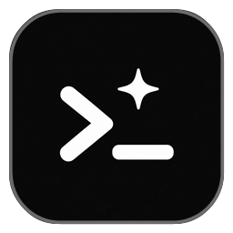
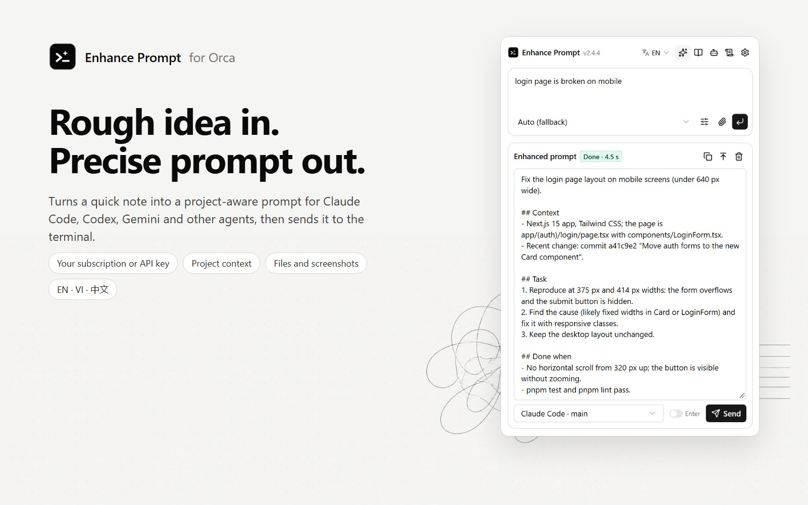
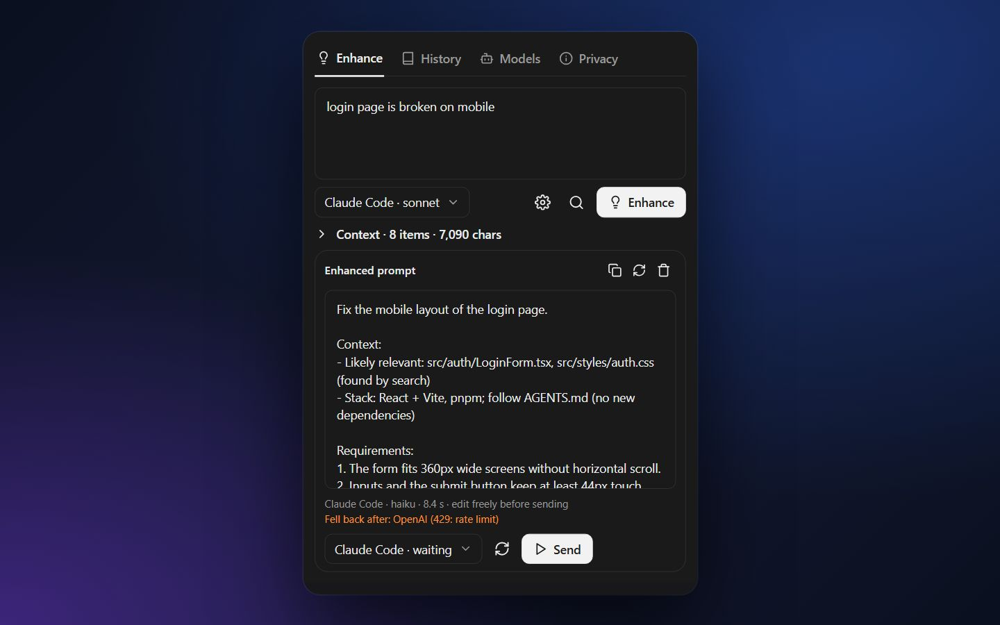
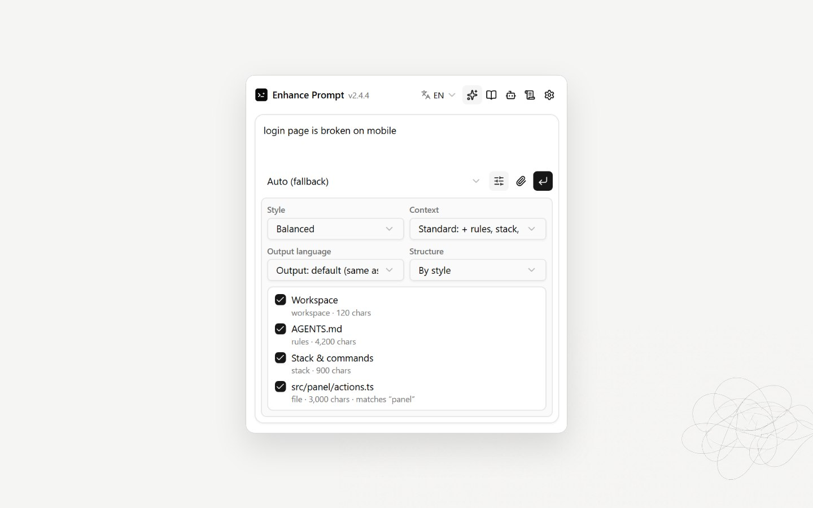
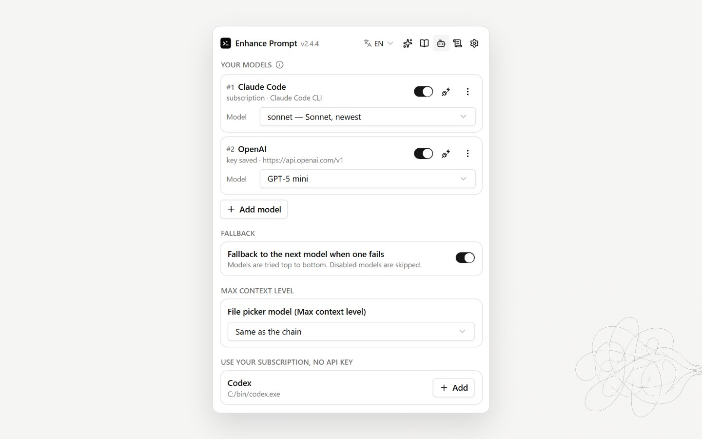
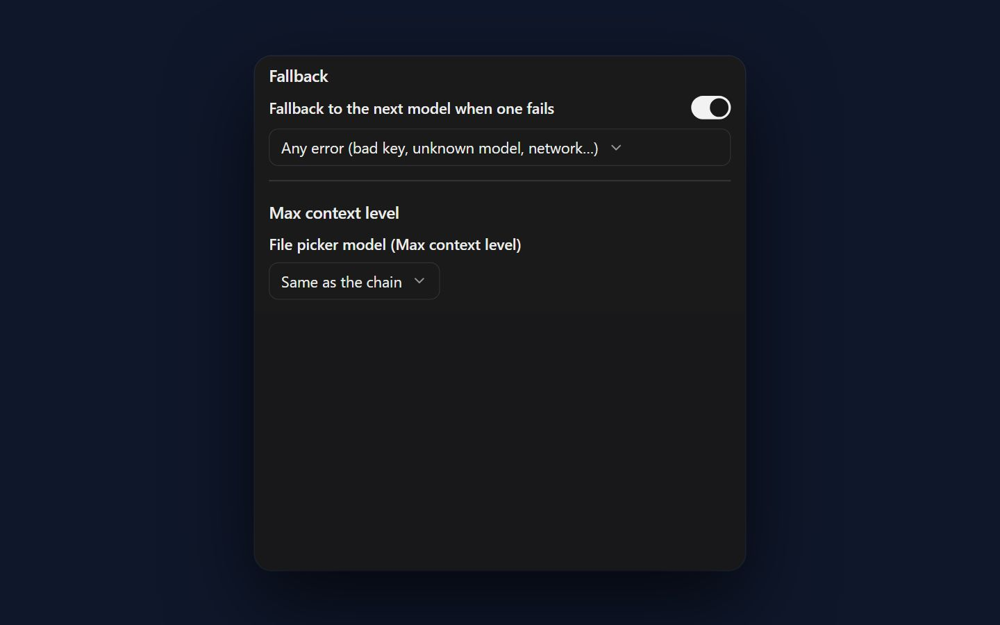
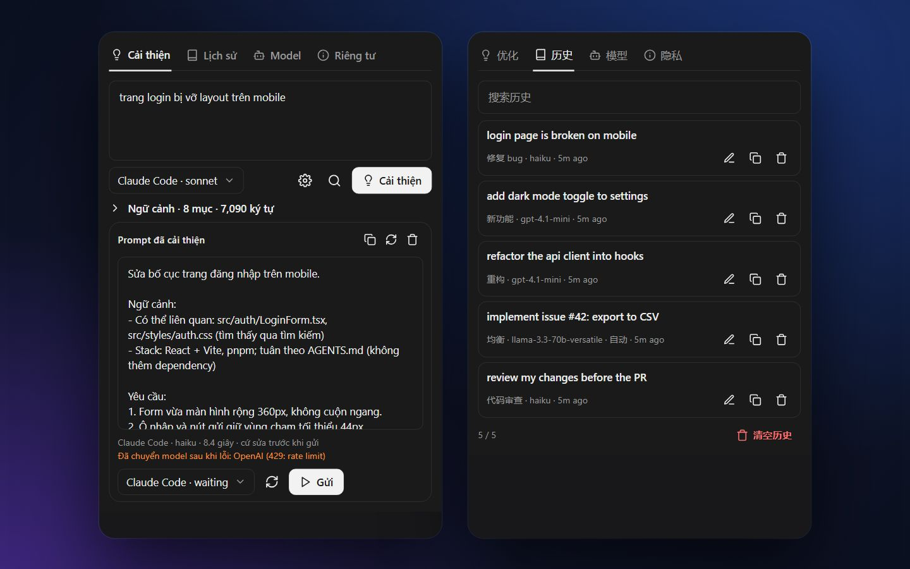
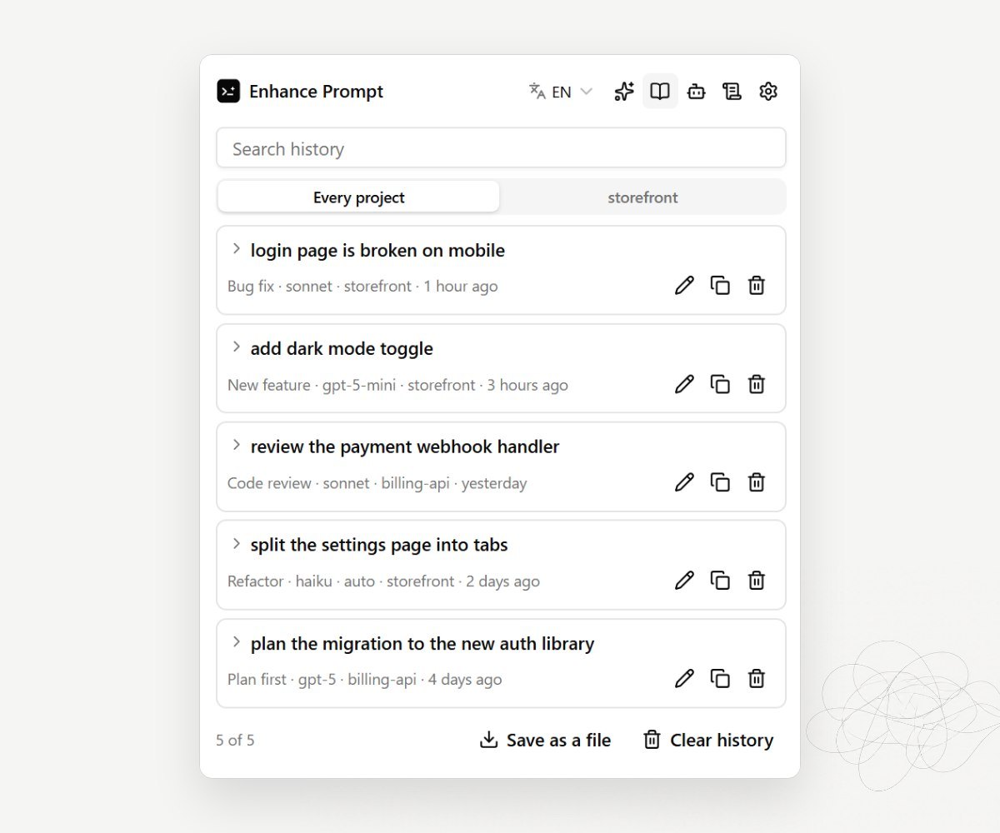

<h1 align="center">
   Enhance Prompt
</h1>

<p align="center">
  <a href="https://github.com/cattfan/orca-enhance-prompt/releases"></a>
  <a href="https://www.onorca.dev/plugins/cattfan/orca-enhance-prompt"></a>
  
  
</p>

<p align="center">
  <sub><a href="docs/readme/README.vi.md">Tiếng Việt</a> · <a href="docs/readme/README.zh-CN.md">中文</a></sub>
</p>

<p align="center">
  <strong>Rough idea in, project-aware prompt out.</strong><br/>
  An <a href="https://github.com/stablyai/orca">Orca</a> plugin that rewrites what you want into a clear prompt grounded in your repo's real files, rules and commands, then sends it straight to Claude Code, Codex, or any agent terminal.
</p>

<h3 align="center"><a href="#install"><ins>Install Enhance Prompt</ins></a></h3>

<p align="center"><a href="https://onorca.dev/plugins/cattfan.enhance-prompt?catalog=community"></a></p>

<p align="center">
  
</p>

## Features

<table>
<tr>
<td width="50%" valign="middle">

### Enhance and Send

Write what you want in a sentence. Enhance rewrites it into a prompt with a goal, requirements and a clear "done when", then sends it to the agent terminal you pick, without pressing Enter until you say so.

[Docs →](docs/getting-started.md)

</td>
<td width="50%">
  <a href="docs/getting-started.md"></a>
</td>
</tr>
<tr>
<td width="50%" valign="middle">

### Grounded in Your Repo

Five context levels, from the prompt alone to your agent rules, stack, git changes and the code that matches the request. See every item that was sent, and untick what you don't want.

[Docs →](docs/context-levels.md)

</td>
<td width="50%">
  <a href="docs/context-levels.md"></a>
</td>
</tr>
<tr>
<td width="50%" valign="middle">

### Use Your Subscription

Claude Code, Codex and Gemini CLI are detected on your machine and added in one click. Enhance runs them one-shot on the plan you already pay for. No API key.

[Docs →](docs/models.md#subscription-clis)

</td>
<td width="50%">
  <a href="docs/models.md#subscription-clis"></a>
</td>
</tr>
<tr>
<td width="50%" valign="middle">

### Any Model, With Fallback

Add OpenAI, Anthropic, OpenRouter, Gemini, Groq, DeepSeek, Mistral, Ollama, LM Studio or any OpenAI-compatible endpoint. Model lists stay current on their own. When one model fails, the next one answers.

[Docs →](docs/models.md)

</td>
<td width="50%">
  <a href="docs/models.md"></a>
</td>
</tr>
<tr>
<td width="50%" valign="middle">

### English, Tiếng Việt, 中文

The panel follows Orca's language or your pick. The enhanced prompt can be written in the language of your request, or in English, Vietnamese or Chinese, per prompt.

[Docs →](docs/settings.md#language)

</td>
<td width="50%">
  <a href="docs/settings.md#language"></a>
</td>
</tr>
<tr>
<td width="50%" valign="middle">

### History

Every enhanced prompt is kept with its style and model. Search it, open it again, or copy it.

[Docs →](docs/getting-started.md#5-reuse-from-history)

</td>
<td width="50%">
  <a href="docs/getting-started.md#5-reuse-from-history"></a>
</td>
</tr>
</table>

**Also in the box:**

- **[Fix this error](docs/rules-and-fixes.md#fix-this-error)**: pick the terminal where the build, tests or dev server failed; Enhance reads the error and writes a bug-fix prompt for your agent.
- **[Your rules and prompt structures](docs/rules-and-fixes.md)**: rules for every workspace or one, and the headings you want prompts written under.
- **[Auto-enhance](docs/auto-enhance.md)**: rewrite the prompts Orca itself sends to agents (launch, task and orchestration prompts), with your rules or a fast model.
- **[Agent-aware prompts](docs/context-levels.md#agent-aware-prompts)**: shaped for Claude Code, Codex, Gemini CLI or Aider when you pick the target terminal.
- **[Nine styles](docs/getting-started.md#styles)**: Balanced, Concise, Detailed spec, Bug fix, New feature, Refactor, Code review, Plan first, or only your own instructions.
- **[Preview context](docs/context-levels.md#see-what-is-sent)**: see what would be sent before any model is called.
- **[Safe by default](docs/privacy.md)**: `.env` files, keys and credentials are never read; prompts go only to the models you set up.

---

## Supported Models

Works with **your subscription CLI** or **any API key**.

<p>
  <kbd>Claude Code (Pro / Max)</kbd> &nbsp;
  <kbd>Codex CLI (ChatGPT)</kbd> &nbsp;
  <kbd>Gemini CLI (Google)</kbd> &nbsp;
  <kbd>OpenAI</kbd> &nbsp;
  <kbd>Anthropic</kbd> &nbsp;
  <kbd>OpenRouter</kbd> &nbsp;
  <kbd>Google Gemini</kbd> &nbsp;
  <kbd>Groq</kbd> &nbsp;
  <kbd>DeepSeek</kbd> &nbsp;
  <kbd>Mistral</kbd> &nbsp;
  <kbd>Ollama</kbd> &nbsp;
  <kbd>LM Studio</kbd> &nbsp;
  <kbd>+ any OpenAI-compatible endpoint or stdin CLI</kbd>
</p>

---

## Install

### From Orca

**[Open in Orca](https://onorca.dev/plugins/cattfan.enhance-prompt?catalog=community)** takes you straight to the plugin's page in Orca. Or by hand:

1. Open **Settings → Plugins**. Once, add the community catalog with **Add marketplace**: URL `https://github.com/stablyai/orca-community-plugins.git`, ref `main`. Turn on the setting that allows full-access plugins.
2. Search for **Enhance Prompt** and click **Install**.
3. Review what it asks for and approve it.
4. Open the right sidebar with `Ctrl+L` (`⌘L` on macOS) and click the **lightbulb** tab. Clicking **Enhance: off** in the status bar does the same.

### From the CLI

```bash
orca plugin install cattfan/orca-enhance-prompt
# Update later
orca plugin update cattfan.enhance-prompt
```

Then follow **[Your first enhanced prompt](docs/getting-started.md)**.

> [!NOTE]
> Requires Orca 1.4.248 or later.

---

## Docs

| Page | What's in it |
| --- | --- |
| [Your first enhanced prompt](docs/getting-started.md) | Open the panel, add a model, enhance, send |
| [Context levels](docs/context-levels.md) | What each level reads and how to control it |
| [Models](docs/models.md) | Subscription CLIs, API keys, live model lists, fallback |
| [Rules, structures and Fix this error](docs/rules-and-fixes.md) | Your rules, prompt headings, fixing an error from a terminal, how prompts are written |
| [Auto-enhance](docs/auto-enhance.md) | Rewriting prompts Orca sends to agents |
| [Settings](docs/settings.md) | Every option, with defaults |
| [Privacy & permissions](docs/privacy.md) | What runs, what is read, where it goes |
| [Troubleshooting & FAQ](docs/troubleshooting.md) | Common problems and fixes |

---

## Community &amp; Support

- **Bugs &amp; ideas:** [Open an issue](https://github.com/cattfan/orca-enhance-prompt/issues).
- **Changelog:** [CHANGELOG.md](CHANGELOG.md) and [releases](https://github.com/cattfan/orca-enhance-prompt/releases).
- **Privacy:** no tracking or analytics. See [Privacy &amp; permissions](docs/privacy.md).
- **Show support:** [Star](https://github.com/cattfan/orca-enhance-prompt) this repo.

---

## Developing

```bash
npm install          # TypeScript and Node types, for type checking only
orca plugin types .  # writes .orca/types
npx tsc -p .
orca plugin test .
orca plugin check .
orca plugin dev watch . --check
```

**Live UI preview:** `npm run dev` opens http://localhost:5173 with every scenario of `src/panel.check.ts` drawn side by side (sample data only). Pick a scenario, switch dark/light, change the panel width, open the folds; it redraws on every save in `src/`. To see the real panel in Orca instead, run `orca plugin dev watch .`: the development folder replaces the installed copy while it runs.

There is no build step: Orca transpiles `src/*.ts(x)` when it loads them. `node scripts/make-images.mjs` regenerates every picture from the panel's `shot-*` scenarios (sample data only), and `node scripts/make-icon.mjs` renders the icon. Releases follow [AGENTS.md](AGENTS.md).

## License

Enhance Prompt is free and open source under the [MIT License](LICENSE). Not affiliated with Orca, Anthropic, OpenAI or Google.
