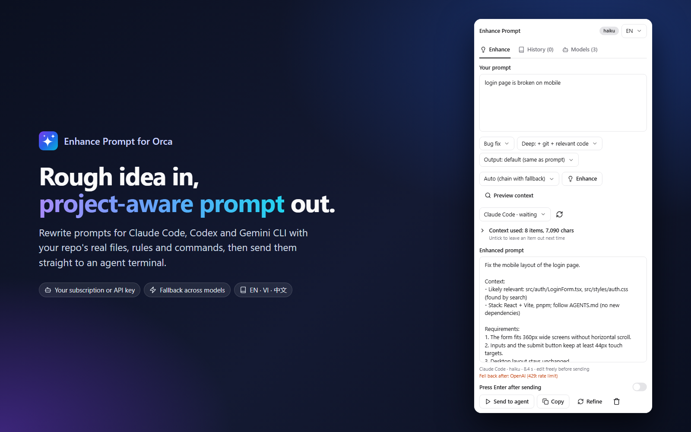
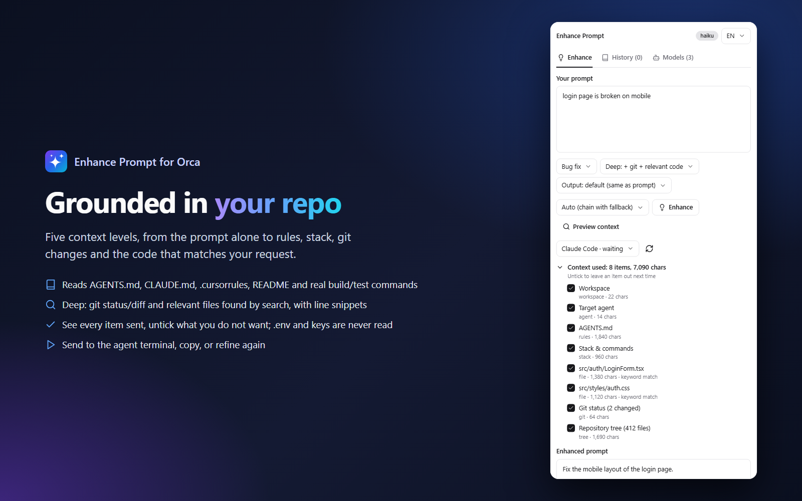
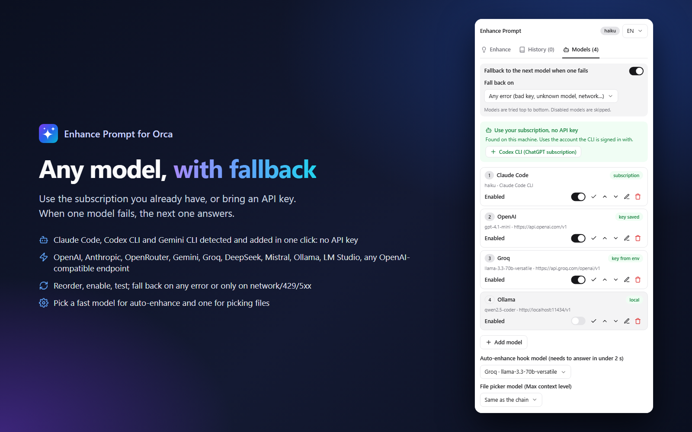
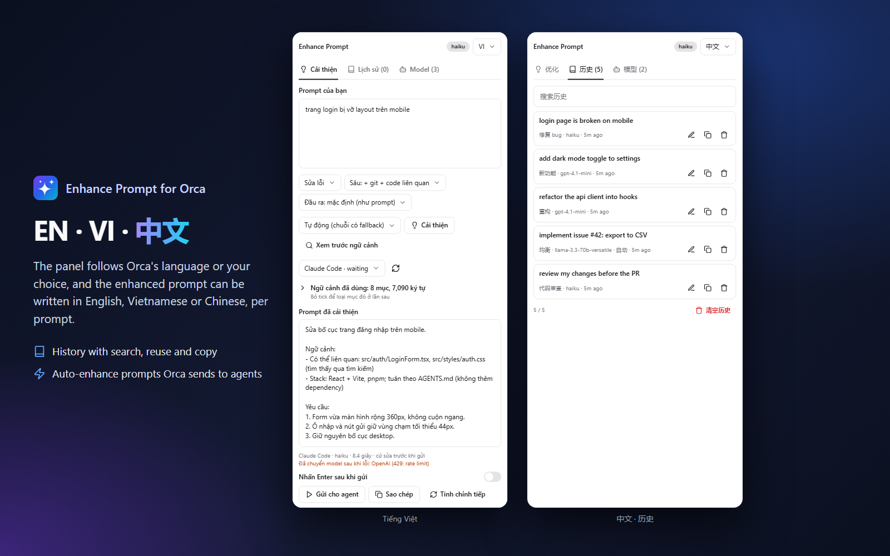
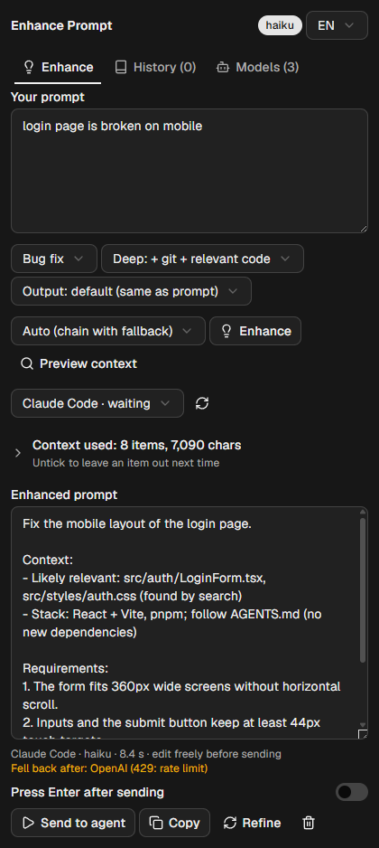

# Enhance Prompt for Orca

Turn a rough idea into a **project-aware** prompt for your coding agents (Claude Code, Codex,
Gemini CLI, OpenCode, Aider…), then send it straight to an agent terminal in [Orca](https://github.com/stablyai/orca).

Like Augment's Prompt Enhancer, the rewrite is grounded in your repository: real file paths,
functions, conventions and test commands, instead of a generic "make it clearer".



| | | |
| --- | --- | --- |
|  |  |  |
| Grounded in your repo | Subscription or API keys, with fallback | EN · VI · 中文 |

<p align="center"><br><sub>The panel in Orca (real capture)</sub></p>

## Features

- **Enhance panel** in the right sidebar: write → Enhance (Ctrl/Cmd+Enter) → edit → **Send to agent** / Copy / Refine.
- **5 context levels**, chosen per prompt or as a default:

  | Level | What the model sees | Speed |
  | --- | --- | --- |
  | Off | only your prompt | fastest |
  | Basic | workspace, branch, target agent | instant |
  | **Standard** (default) | + `AGENTS.md`, `CLAUDE.md`, `GEMINI.md`, `.cursorrules`, `.cursor/rules`, Copilot instructions, a README digest (setup/dev/test sections), stack & real commands (`package.json` scripts, `pyproject`, `go.mod`, `Cargo.toml`, Makefile…), repo tree | ~0.5 s, cached |
  | Deep | + `git status`, recent commits, uncommitted diff, and the code most relevant to the prompt (identifier and path extraction, `git grep`, scoring, numbered snippets) | ~1 s |
  | Max | + files picked by a model from the tree (2-step), and recent output of the target agent terminal | 1 extra model call |

- **Context used** list after each run (or **Preview context** before): untick any item to leave it out next time.
- **Never sent**: `.env*`, `*.pem`/`*.key`, credential and secret files, plus your own exclude patterns (lockfiles, `dist/`… by default).
- **Agent-aware**: shapes the prompt for Claude Code, Codex, Gemini CLI or Aider when you pick a target terminal.
- **Use your subscription, no API key**: Claude Code (Claude Pro/Max), Codex CLI (ChatGPT plan),
  Gemini CLI (Google account) or any CLI that reads stdin. Detected automatically, added in one click,
  run one-shot in an empty temp folder with no tools.
- **Multiple models with fallback**: add as many as you like (OpenAI, Anthropic, OpenRouter, Google Gemini, Groq,
  DeepSeek, Mistral, Ollama, LM Studio, any OpenAI-compatible endpoint), reorder them, enable/disable, test.
  When one fails the next is tried, on any error or only on network/timeout/429/5xx. Pick a model per prompt,
  a fast model for auto-enhance, and a model for the Max-level file picker.
- **Styles**: Balanced, Concise, Detailed spec, Bug fix, New feature, Refactor, Code review, Plan first, Custom.
- **Languages**: the panel in English, Tiếng Việt or 中文 (follows Orca or your pick, top-right of the panel);
  the enhanced prompt in the same language as your prompt, or EN / VI / ZH (and more in Settings), per prompt.
- **History** with search, reuse, copy and delete.
- **Auto-enhance** (off by default) for prompts *Orca* sends to agents (launch, task and orchestration
  prompts) through the `agent.prompt.before` hook:
  - *Rules*: instantly appends your text (e.g. "run the tests and summarize the changes").
  - *AI*: rewrites with your hook model using the warm cached project context. Orca waits at most 2 s,
    so pick a fast model; if it runs out of time, the original prompt is sent unchanged.
  - Toggle it from the status bar item or the command palette (`Enhance Prompt: Auto-enhance off / with rules / with AI`).
  - Orca's status bar right-click menu only lists Orca's own items, so the plugin's item is shown, shrunk
    to an icon or hidden with the **Status bar item** setting or `Enhance Prompt: Show / hide status bar item`.
  - Orca never hooks prompts you type yourself into a terminal; use the panel for those.
- **Sending**: multi-line prompts use bracketed paste so agent TUIs keep the line breaks (or raw /
  single line). "Press Enter after sending" is off by default so you can review first.

## Setup

1. Install from the Orca plugin directory (or `orca plugin install cattfan/orca-enhance-prompt`).
2. Panel → **Models** tab. If Claude Code / Codex / Gemini CLI is installed and signed in, click it under
   *Use your subscription*: done, no key needed. Or **Add model**: pick a preset, paste the API key (stored encrypted by Orca), **Test**.
   Add a second model to get fallback. Keys in `OPENAI_API_KEY`, `ANTHROPIC_API_KEY`, `OPENROUTER_API_KEY`,
   `GEMINI_API_KEY`, `GROQ_API_KEY`, `DEEPSEEK_API_KEY` or `MISTRAL_API_KEY` are picked up automatically.
3. Everything else (default style and context level, language, custom instructions, extra files,
   exclusions, fallback, auto-enhance) is in Settings → Plugins → Enhance Prompt.

## Permissions

| Capability | Why |
| --- | --- |
| `storage:own`, `settings:own`, `secrets:own` | History, model profiles, settings, API keys |
| `workspace:read` | Workspace name/branch/folder, its terminals, and keeping context warm when you switch workspace |
| `agent:read` | Listing agent terminals and knowing which agent you target |
| `terminal:send` | Typing the prompt into the agent terminal you pick |
| `terminal:read` | Max context level only: recent output of the target terminal |

Subscription models run the CLI you picked (`claude -p`, `codex exec --sandbox read-only`, `gemini -p`) with
the prompt on stdin, in an empty temporary folder; they are skipped by auto-enhance (too slow for its 2 s).

The worker also runs read-only `git` commands (`status`, `log`, `diff`, `ls-files`, `grep`) in the
focused workspace for the Standard level and above. SSH/WSL workspaces get workspace/agent context only.

## Privacy

There is no tracking, analytics or telemetry. Your prompt, plus the context you choose (always shown
in "Context used"), goes only to the model endpoints you configured. API keys stay in Orca's encrypted
secrets store. Copy uses the OS clipboard tool (`clip.exe`, `pbcopy`, `wl-copy`/`xclip`/`xsel`) with the
text passed on stdin.

See [CHANGELOG.md](CHANGELOG.md) for what changed in each version.

## Development

```sh
npm install          # TypeScript + @types/node for type checking only
orca plugin types .  # writes .orca/types
npm run typecheck
npm test             # orca plugin test .
npm run check        # orca plugin check .
orca plugin dev watch . --check
```

There is no build step: Orca transpiles `src/*.ts(x)` when it loads them.

Listing images: `node scripts/make-images.mjs` renders the `shot-*` scenarios of `src/panel.check.ts`
(sample data only) the way Orca draws them and saves `assets/cover.png` and `assets/screenshots/*.png`.

## Release

Bump `version` in `orca-plugin.json`, add the section to `CHANGELOG.md`, then:

```sh
node scripts/release.mjs 1.3.0   # checks, commit, tag v1.3.0, push, GitHub release with the changelog notes
```

Listing status: https://www.onorca.dev/plugins/cattfan/orca-enhance-prompt

## License

MIT
