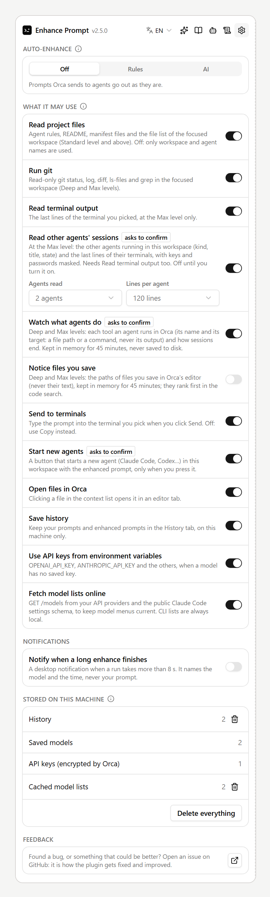

# Context levels

The more of your project the model sees, the more specific the prompt it writes: real file paths, the commands your repo actually uses, the conventions in your agent rules. Pick a level per prompt in the **Context** menu, or set the default under **Settings → Plugins → Enhance Prompt → Project context level**.

| Level | Adds | Typical time |
| --- | --- | --- |
| **Off** | Only your prompt | — |
| **Basic** | Workspace name and branch, the target agent | instant |
| **Standard** (default) | Agent rule files, a README digest, stack and commands, the repo tree | ~0.5 s, then cached |
| **Deep** | Git status, recent commits, uncommitted diff, up to 6 files relevant to your request | ~1 s |
| **Max** | Up to 10 files, some picked by a model from the tree, plus recent output of the target terminal | one extra model call |

## What each level reads

### Basic

- The focused workspace's name and branch.
- The agent in the terminal you picked in **Send to** (Claude Code, Codex…), so the prompt can be [shaped for it](#agent-aware-prompts).

### Standard

- **Agent rules**: `AGENTS.md`, `CLAUDE.md`, `GEMINI.md`, `.github/copilot-instructions.md`, `.cursorrules`, `.windsurfrules`, `.clinerules`, `CONTRIBUTING.md` and up to four `.cursor/rules` files.
- **README digest**: the intro plus the sections about install, setup, usage, development, tests, build and architecture, not just the first few kilobytes.
- **Stack and commands**: package manager and scripts from `package.json`, `pyproject.toml`, `requirements.txt`, `go.mod`, `Cargo.toml`, Maven, Gradle, .NET, Flutter, Docker, Makefile and justfile targets, CI workflows. This is how the prompt ends with a test command that works in your repo.
- **Repo tree**: folders two levels deep with file counts.
- Any files you list in **Always include files**.

This part does not depend on your prompt, so it is cached per workspace and refreshed when you switch workspaces.

### Deep

- **Git**: `git status`, the last 6 commits, and the uncommitted diff (trimmed).
- **Relevant code**: keywords, identifiers, paths and dotted names such as `agent.prompt.before` are taken from your request. Each one is searched with `git grep` and weighted by how rare it is in the repo, so a specific name beats a common word like "timeout". File names that match count too, and so do files you changed. The best files are included as numbered snippets around the matching lines.

Write the names you know, in backticks if you like (`` `validateSession` ``, `src/auth/session.ts`), and Deep will find them. Requests in Vietnamese or Chinese work too: identifiers and paths are matched as they are.

### Max

- Everything in Deep, with up to 10 files.
- A model reads the file list and picks the files it thinks matter. This uses the **File picker model** from the Models tab, or your model chain.
- The last lines of the target agent's terminal (100 by default, see **Terminal lines** in [Settings](settings.md#context)), useful when the agent just failed and you want to tell it what to do next.
- With **Privacy → Read other agents' sessions** on (it starts off): the other agents running in the same workspace (kind, title, state) and the last lines of their terminals, so the prompt knows what the other agents are doing. How many agents (1 to 8, 4 by default) and how many lines of each terminal (10 to 300, 80 by default) is set under the switch in the panel's Settings, or in Orca's Settings; keys and passwords are masked, and the sessions are listed after everything else so they never push out project context. Untick **Other agents** to leave them out of a run.

  

## See what is sent

- Opening **Options** gathers everything for the current level without calling a model, and lists it below the options.
- After each enhance, that list shows each item used, with its size. Untick an item and it is left out of the next enhance.
- Items are kept in priority order (rules, stack, files, git, terminal, tree) and trimmed to fit a budget per level, so a huge README cannot crowd out your code.

## Never sent

- `.env` and `.env.*` files, `*.pem`, `*.key`, `*.p12`, keystores, SSH keys, and any file named like `secret` or `credentials` are never read, listed, searched or diffed.
- Binary files.
- Anything matching **Exclude from code search** (by default `dist/`, `build/`, `out/`, `coverage/`, lockfiles, minified files and source maps).

## Agent-aware prompts

With a target terminal picked and **Adapt to the target agent** on, the prompt is shaped for that agent:

| Agent | Shape |
| --- | --- |
| Claude Code | Markdown sections or XML tags, a plan or todo list for multi-step work, the exact verification command |
| Codex | Short imperative bullets, explicit paths, the exact test or lint command |
| Gemini CLI | Numbered steps, explicit paths, what to verify |
| Aider | The files to add first, then the change |
| Others | Explicit paths, clear steps, a verification command |

## Remote workspaces

For SSH and WSL workspaces, the plugin can't read files on the remote host. These get **Basic** context; the panel says so in the context list under **Options**.
