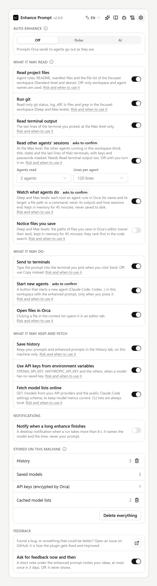
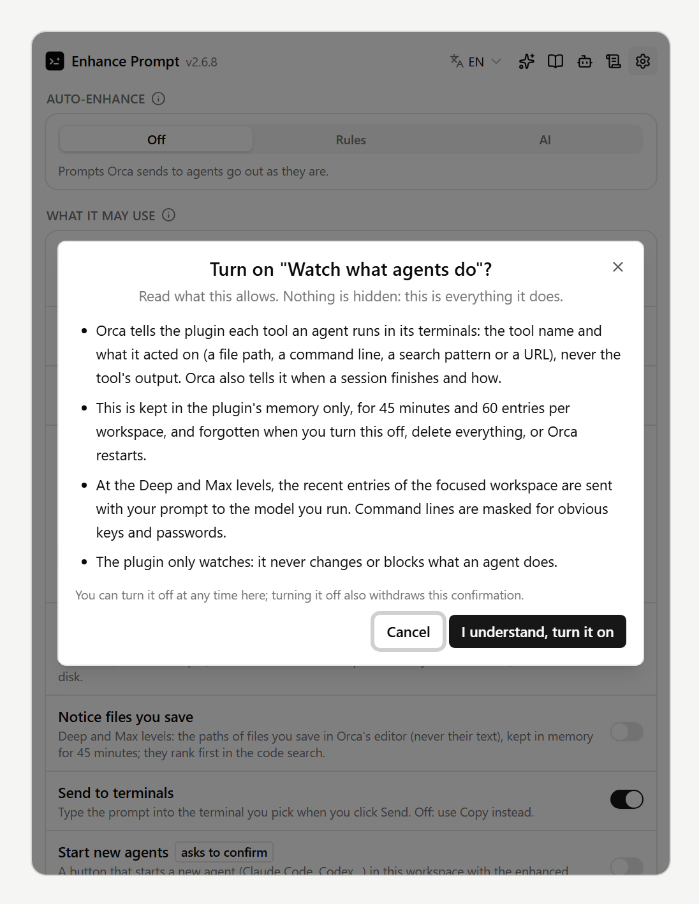

# Privacy & permissions

Enhance Prompt has no tracking, analytics or telemetry, and no server of its own.

## Turn things off

Orca approves a plugin's access as a whole: it shows everything the plugin may do and asks once. The panel's **Settings** section (gear icon; it also holds auto-enhance and stored data) and **Settings → Plugins → Enhance Prompt → Privacy: …** decide what the plugin actually uses. The worker checks these switches before every read, send, save or download, so a switch that is off is never bypassed.

| Switch | Off means |
| --- | --- |
| Read project files | No rules, README, manifests or file list; Standard and above fall back to workspace and agent names |
| Run git | No `git` commands; files are listed by walking the folder |
| Read terminal output | The Max level skips the terminal (and the other agents' sessions) |
| Read other agents' sessions (**off by default, asks to confirm**) | At the Max level, the other agents in the workspace and the last lines of their terminals are left out. On: their kind, title and state, and the last lines of each terminal, with keys, tokens and passwords masked. You set how many agents (1 to 8, 4 by default) and lines (10 to 300, 80 by default) under the switch; the amounts do nothing while it is off |
| Watch what agents do (**off by default, asks to confirm**) | Nothing is kept. On: each tool an agent runs in Orca (its name and target: a file path or a command, never its output) and how sessions end, kept in memory for 45 minutes and sent with prompts at Deep and Max |
| Notice files you save (**off by default**) | Nothing is kept. On: the paths (never the text) of files you save in Orca's editor, in memory for 45 minutes; they rank first in the code search at Deep and Max |
| Send to terminals | **Send** is refused; use **Copy** |
| Start new agents (**off by default, asks to confirm**) | No button. On: a button that starts a new agent in the workspace with the enhanced prompt, only when you press it; the agent runs with your user account |
| Open files in Orca | No open button on files in the context list |
| Save history | Nothing is added to History |
| Use API keys from environment variables | Only keys you saved in the Models tab |
| Fetch model lists online | No `GET /models` or schema download; CLI lists still come from your machine |

### Switches that ask to confirm

**Read other agents' sessions**, **Watch what agents do** and **Start new agents** send more of your work to the model or start programs. Turning one on in the panel first shows everything it allows, in plain words, with **I understand, turn it on** and **Cancel**. Turned on in Orca's Settings alone, it stays off (the panel says so and offers to confirm). Turning it off withdraws the confirmation; **Delete everything** withdraws all of them.

**Notify when a long enhance finishes** (Settings section, off by default) shows a desktop notification after runs longer than 8 s; it names the model and the time, never your prompt.

The same section shows what is stored and has **Clear history**, **Clear model lists** and **Delete everything** (history, model lists, saved models and their keys, your rules and structures, the confirmations, the saved drafts and results, and the files you attached; press twice).

## Where your prompt goes

- Your prompt, plus the context items listed under **Options**, is sent **only to the model you run**: the API endpoint of that model profile, or the subscription CLI on your machine, which talks to its own provider.
- With fallback on, a failed request is retried on your next model.
- Files you attach: images go with it to models that read images (Anthropic, and the OpenAI, OpenRouter and Gemini presets; Codex CLI with `-i`). Other models get only their paths. Text files join the context (of a long one, the beginning and the end: 20,000 characters in all) unless you untick them in the context list. Only files you attached in the panel are read this way. The enhanced prompt lists the paths so your agent can open the files.
- Model lists are fetched from the same providers (`GET /models`), from the CLIs themselves, and, for Claude Code aliases, from the public [Claude Code settings schema](https://www.schemastore.org/claude-code-settings.json). Nothing about you or your project is sent with these.

## What is read on your machine

- At the Standard level and above: the agent rule files, README, manifest files and file list of the focused workspace, through read-only `git` commands (`ls-files`, `status`, `log`, `diff`, `grep`) and file reads.
- At the Max level: the last lines of the terminal you picked.
- Files you paste, drop or pick: copied into a temporary folder on this machine (removed after a day) and read when you press Enhance. Nothing else is read.
- **Never**: `.env*`, `*.pem`, `*.key`, `*.p12`, keystores, SSH keys, files named like `secret` or `credentials`, binary files, and anything matching your exclude patterns.
- `~/.claude/settings.json`, `~/.codex/config.toml` and `~/.gemini/settings.json`, only to read which model you use and which models you allow.

## What is stored

| Where | What |
| --- | --- |
| Orca's encrypted secrets | API keys you paste |
| The plugin's own storage | Model profiles, history, cached model lists, your rules and prompt structures, and which switches you confirmed |
| The panel's saved state (kept by Orca for the panel) | Your picks in the panel (section, style, context level, model, output language), which workspace each terminal belongs to, and for the feedback note: how many prompts you enhanced before it first showed (it stops counting at five) and when it last showed. While **Save history** is on, also each project's draft, last result and context list, so they are there when you open the panel again; with it off, they are gone when the panel closes |
| Orca settings | The options on the [Settings](settings.md) page |
| The system's temporary folder | The files you paste, drop or pick (removed after a day) |

Nothing else is written to disk. Project context, what agents do and the paths of the files you save in Orca's editor are kept in memory only, and a subscription CLI runs in a temporary folder that is deleted afterwards. Clear any of it from the panel's **Settings** section.

## Permissions

| Capability | Why |
| --- | --- |
| `storage:own`, `settings:own`, `secrets:own` | Profiles, history, settings, API keys |
| `workspace:read` | Workspace name, branch and folder, its terminals, and keeping context warm when you switch workspace |
| `agent:read` | Listing agent terminals and knowing which agent you target; with **Watch what agents do** on, how agent sessions end |
| `terminal:send` | Typing the prompt into the terminal you pick in **Send to** |
| `terminal:read` | Max context level only: recent output of the target terminal, and of the other agents' terminals while **Read other agents' sessions** is on |
| `agent:launch` | The **Start** button under the result, only while **Start new agents** is on and confirmed |
| `workspace:write` | Opening a file of the context list in an editor tab (**Open files in Orca**). The plugin never writes to your files |
| `notifications:show` | The notification when a long enhance finishes, when you turn it on |

It also registers three hooks: `agent.prompt.before` for [auto-enhance](auto-enhance.md), and `agent.tool.after` and `editor.save.before`, which only observe (**Watch what agents do**, **Notice files you save**) and never change or block anything; while those switches are off, what they receive is dropped.

The plugin runs as a worker process (`trusted-worker`), because it calls model APIs, runs CLIs and `git`, and reads project files. Orca asks you to approve it on install, and again when an update asks for more.

## Subscription CLIs

When you use a subscription CLI, the prompt is passed on stdin to a fixed command (`claude -p`, `codex exec --sandbox read-only`, `gemini -p`) running in an empty temporary folder that is deleted afterwards. Claude Code runs with no tools; Codex runs in a read-only sandbox.

## Clipboard

**Copy** uses your OS clipboard tool (`clip.exe`, `pbcopy`, `wl-copy`, `xclip` or `xsel`) with the text passed on stdin.
