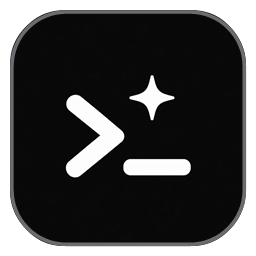
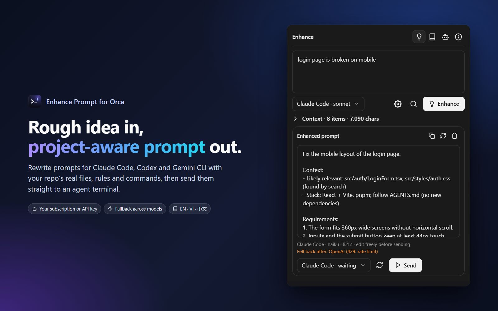
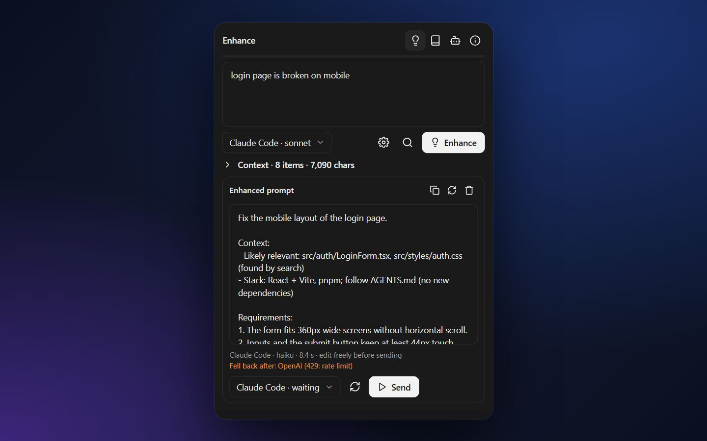
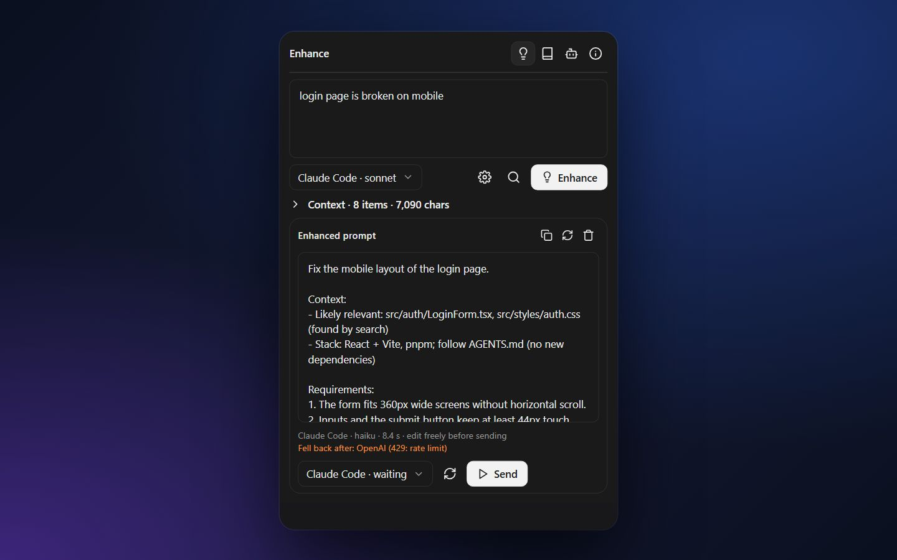
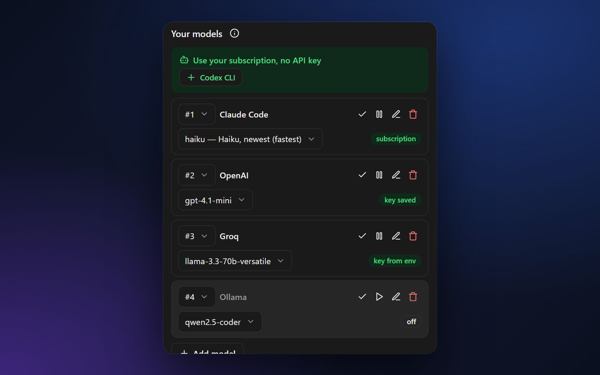
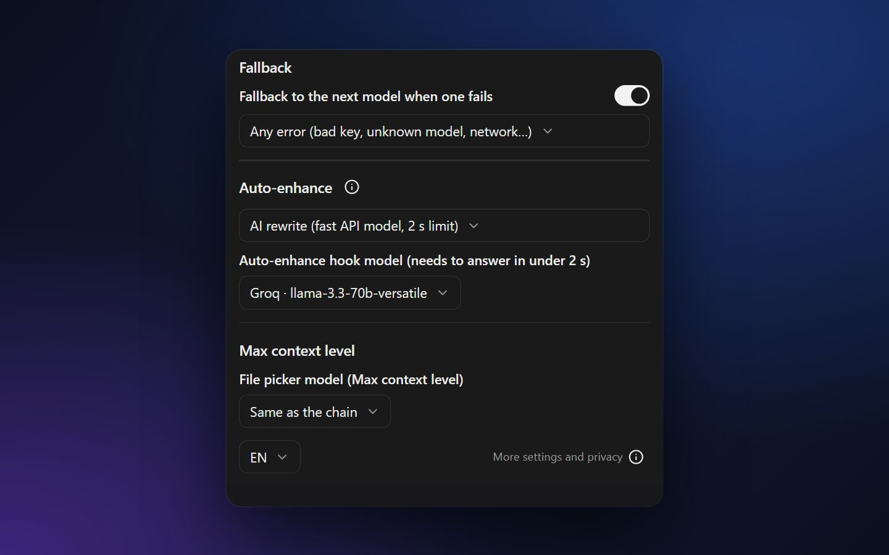
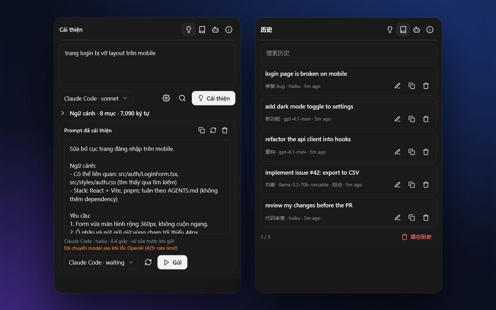
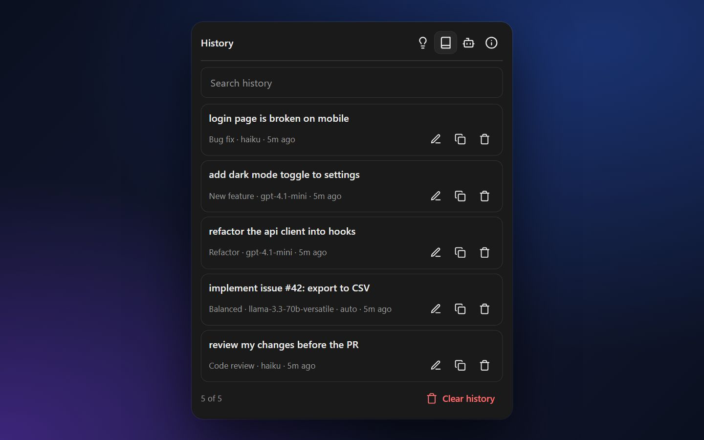

<h1 align="center">
   Enhance Prompt
</h1>

<p align="center">
  <a href="https://github.com/cattfan/orca-enhance-prompt/releases"></a>
  <a href="https://www.onorca.dev/plugins/cattfan/orca-enhance-prompt"></a>
  
  
</p>

<p align="center">
  <sub><a href="../../README.md">English</a> · <a href="README.zh-CN.md">中文</a></sub>
</p>

<p align="center">
  <strong>Ý tưởng thô vào, prompt hiểu dự án ra.</strong><br/>
  Plugin cho <a href="https://github.com/stablyai/orca">Orca</a>: viết lại yêu cầu của bạn thành một prompt rõ ràng, dựa trên file, luật và lệnh thật trong repo, rồi gửi thẳng tới Claude Code, Codex hay bất kỳ terminal agent nào.
</p>

<h3 align="center"><a href="#cài-đặt"><ins>Cài Enhance Prompt</ins></a></h3>

<p align="center">
  
</p>

## Tính năng

<table>
<tr>
<td width="50%" valign="middle">

### Cải thiện và gửi

Gõ một câu mô tả việc cần làm. Enhance viết lại thành prompt có mục tiêu, yêu cầu và tiêu chí "xong khi nào", rồi gửi vào terminal agent bạn chọn, không tự nhấn Enter nếu bạn chưa muốn.

[Hướng dẫn →](../getting-started.md)

</td>
<td width="50%">
  
</td>
</tr>
<tr>
<td width="50%" valign="middle">

### Hiểu đúng repo của bạn

Năm mức ngữ cảnh, từ chỉ prompt tới luật agent, stack, thay đổi git và đoạn code khớp với yêu cầu. Xem từng mục đã gửi và bỏ tick mục không muốn.

[Hướng dẫn →](../context-levels.md)

</td>
<td width="50%">
  
</td>
</tr>
<tr>
<td width="50%" valign="middle">

### Dùng gói subscription

Claude Code, Codex và Gemini CLI trên máy được tự phát hiện, bấm một lần là thêm. Enhance chạy chúng một lần trên chính gói bạn đang trả tiền, không cần API key.

[Hướng dẫn →](../models.md#subscription-clis)

</td>
<td width="50%">
  
</td>
</tr>
<tr>
<td width="50%" valign="middle">

### Mọi model, có fallback

OpenAI, Anthropic, OpenRouter, Gemini, Groq, DeepSeek, Mistral, Ollama, LM Studio hoặc endpoint tương thích OpenAI. Danh sách model tự cập nhật. Model này lỗi thì model kế tiếp trả lời.

[Hướng dẫn →](../models.md)

</td>
<td width="50%">
  
</td>
</tr>
<tr>
<td width="50%" valign="middle">

### English, Tiếng Việt, 中文

Panel theo ngôn ngữ của Orca hoặc theo lựa chọn của bạn. Prompt đầu ra có thể cùng ngôn ngữ với yêu cầu, hoặc tiếng Anh, Việt, Trung, chọn riêng cho từng lần.

[Hướng dẫn →](../settings.md#language)

</td>
<td width="50%">
  
</td>
</tr>
<tr>
<td width="50%" valign="middle">

### Lịch sử

Mọi prompt đã cải thiện đều được lưu kèm kiểu và model. Tìm kiếm, mở lại hoặc sao chép.

[Hướng dẫn →](../getting-started.md#5-reuse-from-history)

</td>
<td width="50%">
  
</td>
</tr>
</table>

**Ngoài ra:**

- **[Tự cải thiện](../auto-enhance.md)**: viết lại prompt mà chính Orca gửi cho agent (khi launch, task, orchestration), bằng luật của bạn hoặc một model nhanh.
- **[Prompt theo từng agent](../context-levels.md#agent-aware-prompts)**: định dạng hợp với Claude Code, Codex, Gemini CLI hay Aider.
- **[Chín kiểu prompt](../getting-started.md#styles)**: Cân bằng, Ngắn gọn, Đặc tả chi tiết, Sửa lỗi, Tính năng mới, Refactor, Review code, Lập kế hoạch trước, Chỉ hướng dẫn riêng.
- **[An toàn mặc định](../privacy.md)**: không bao giờ đọc file `.env`, key hay credentials; prompt chỉ gửi tới model bạn cấu hình.

---

## Cài đặt

### Từ Orca

**[Mở trong Orca](https://onorca.dev/plugins/cattfan.enhance-prompt?catalog=community)** đưa bạn thẳng tới trang của plugin trong Orca. Hoặc làm tay:

1. Mở **Settings → Plugins**. Lần đầu, thêm catalog cộng đồng bằng **Add marketplace**: URL `https://github.com/stablyai/orca-community-plugins.git`, ref `main`. Bật setting cho phép plugin full access.
2. Tìm **Enhance Prompt** và bấm **Install**.
3. Xem các quyền plugin xin và duyệt.
4. Mở thanh bên phải bằng `Ctrl+L` (`⌘L` trên macOS) rồi bấm tab **bóng đèn**. Bấm **Enhance: off** ở thanh trạng thái cũng được.

### Từ CLI

```bash
orca plugin install cattfan/orca-enhance-prompt
# Cập nhật sau này
orca plugin update cattfan.enhance-prompt
```

Sau đó làm theo **[Prompt đầu tiên](../getting-started.md)**.

> [!NOTE]
> Cần Orca 1.4.248 trở lên.

---

## Tài liệu

Tài liệu chi tiết bằng tiếng Anh:

| Trang | Nội dung |
| --- | --- |
| [Your first enhanced prompt](../getting-started.md) | Mở panel, thêm model, cải thiện, gửi |
| [Context levels](../context-levels.md) | Mỗi mức đọc gì và cách kiểm soát |
| [Models](../models.md) | CLI subscription, API key, danh sách model, fallback |
| [Auto-enhance](../auto-enhance.md) | Tự cải thiện prompt Orca gửi cho agent |
| [Settings](../settings.md) | Mọi tuỳ chọn và giá trị mặc định |
| [Privacy & permissions](../privacy.md) | Chạy gì, đọc gì, gửi đi đâu |
| [Troubleshooting & FAQ](../troubleshooting.md) | Lỗi thường gặp và cách xử lý |

---

## Giấy phép

Enhance Prompt miễn phí và mã nguồn mở theo [giấy phép MIT](../../LICENSE). Không liên kết với Orca, Anthropic, OpenAI hay Google.
