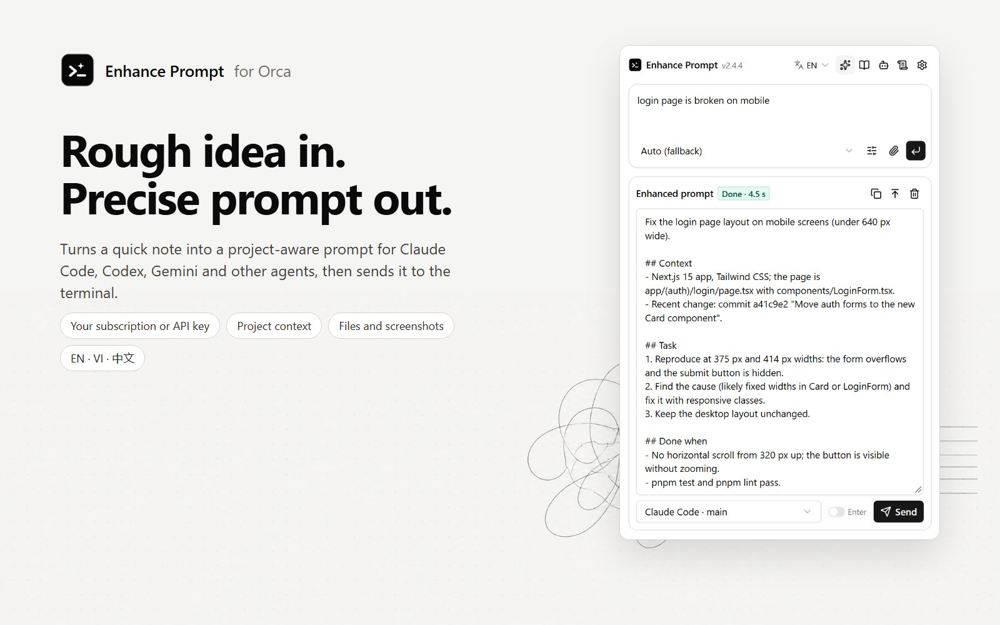
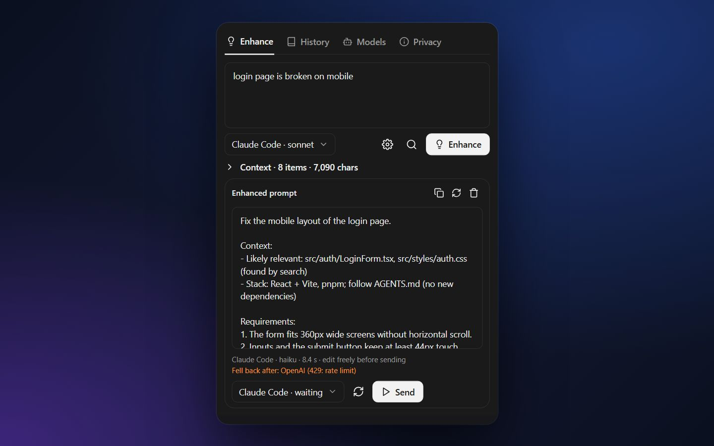
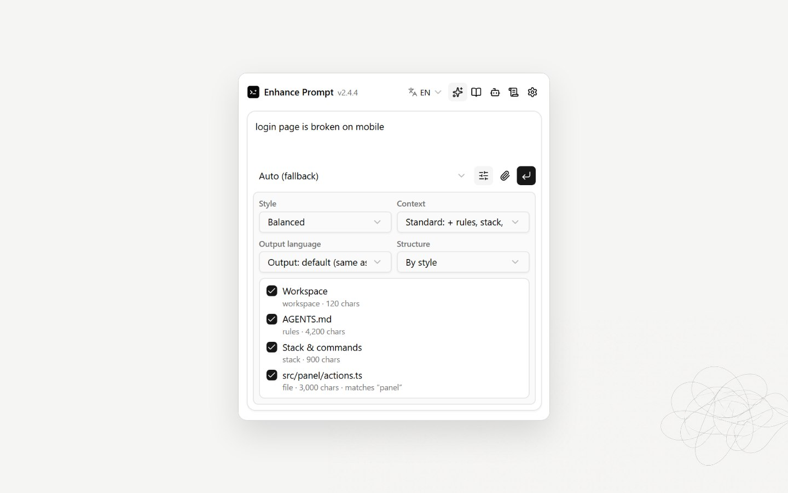
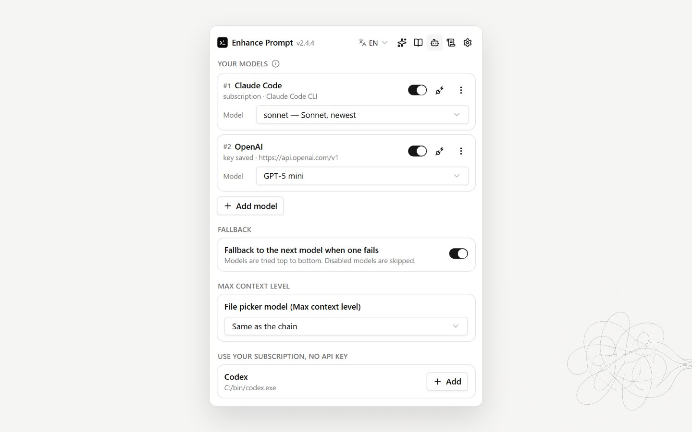
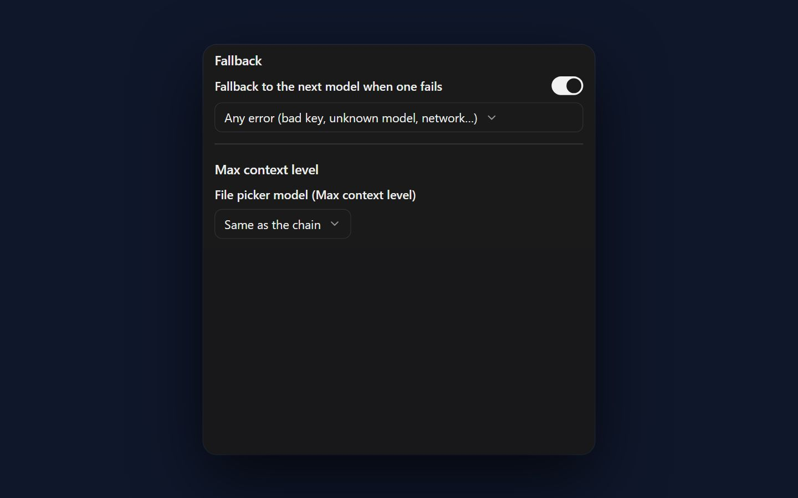
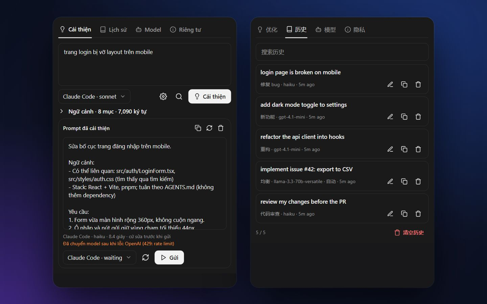
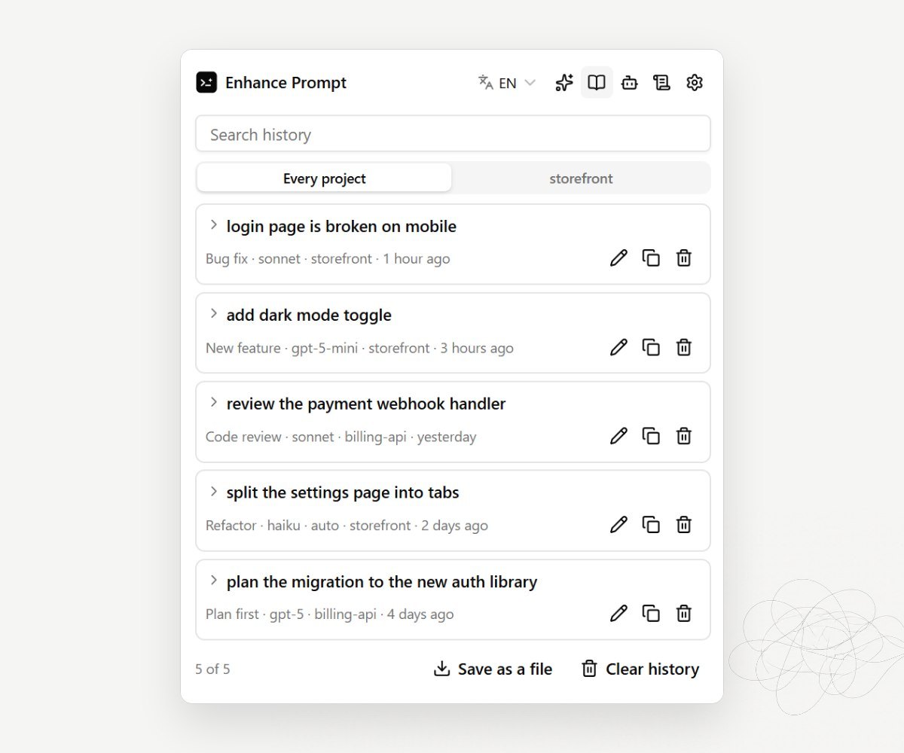

<h1 align="center">
   Enhance Prompt
</h1>

<p align="center">
  <a href="https://github.com/cattfan/orca-enhance-prompt/releases"></a>
  <a href="https://www.onorca.dev/plugins/cattfan/orca-enhance-prompt"></a>
  
  
</p>

<p align="center">
  <sub><a href="../../README.md">English</a> · <a href="README.vi.md">Tiếng Việt</a></sub>
</p>

<p align="center">
  <strong>粗略的想法进去，懂项目的提示词出来。</strong><br/>
  一个 <a href="https://github.com/stablyai/orca">Orca</a> 插件：把你的需求改写成清晰的提示词，基于仓库里真实的文件、规则和命令，然后直接发送给 Claude Code、Codex 或任何 agent 终端。
</p>

<h3 align="center"><a href="#安装"><ins>安装 Enhance Prompt</ins></a></h3>

<p align="center">
  
</p>

## 功能

<table>
<tr>
<td width="50%" valign="middle">

### 优化并发送

用一句话描述需求。优化后得到包含目标、要求和完成标准的提示词，发送到你选择的 agent 终端；在你确认前不会自动回车。

[文档 →](../getting-started.md)

</td>
<td width="50%">
  
</td>
</tr>
<tr>
<td width="50%" valign="middle">

### 基于你的仓库

五个上下文级别：从仅提示词，到 agent 规则、技术栈、git 变更以及与需求匹配的代码。每一项发送内容都可查看，也可取消勾选。

[文档 →](../context-levels.md)

</td>
<td width="50%">
  
</td>
</tr>
<tr>
<td width="50%" valign="middle">

### 使用你的订阅

自动发现本机的 Claude Code、Codex 和 Gemini CLI，一键添加。直接使用你已付费的订阅，无需 API key。

[文档 →](../models.md#subscription-clis)

</td>
<td width="50%">
  
</td>
</tr>
<tr>
<td width="50%" valign="middle">

### 任意模型，自动回退

OpenAI、Anthropic、OpenRouter、Gemini、Groq、DeepSeek、Mistral、Ollama、LM Studio 或任何 OpenAI 兼容端点。模型列表自动保持最新；一个模型失败时，下一个接手。

[文档 →](../models.md)

</td>
<td width="50%">
  
</td>
</tr>
<tr>
<td width="50%" valign="middle">

### English、Tiếng Việt、中文

面板跟随 Orca 的语言或你的选择。优化结果可以与需求同语言，也可以按次选择英文、越南语或中文。

[文档 →](../settings.md#language)

</td>
<td width="50%">
  
</td>
</tr>
<tr>
<td width="50%" valign="middle">

### 历史

每条优化过的提示词都会连同风格和模型一起保存，可搜索、重新打开或复制。

[文档 →](../getting-started.md#5-reuse-from-history)

</td>
<td width="50%">
  
</td>
</tr>
</table>

**另外还有：**

- **[文件和截图](../user-guide.md#2-attach-files-and-screenshots)**：粘贴截图、拖放或附加文件；能看图的模型会使用图片，文本文件加入上下文（长文件只取开头和结尾），提示词会为 agent 列出每个文件路径。
- **[规则与提示词结构](../rules-and-fixes.md)**：适用于当前项目的规则，以及提示词要使用的标题（内置结构也可编辑）。
- **[新功能](../user-guide.md#8-whats-new)**：点击面板中的版本号，查看本版说明和完整更新日志。
- **[自动优化](../auto-enhance.md)**：改写 Orca 自己发给 agent 的提示词（启动、任务、编排），使用你的规则或快速模型。
- **[按 agent 定制](../context-levels.md#agent-aware-prompts)**：针对 Claude Code、Codex、Gemini CLI 或 Aider 调整格式。
- **[九种风格](../getting-started.md#styles)**：均衡、简洁、详细规格、修复 bug、新功能、重构、代码审查、先做计划、仅自定义指令。
- **[默认安全](../privacy.md)**：从不读取 `.env`、密钥和凭据文件；提示词只发送到你配置的模型。

---

## 安装

### 在 Orca 中

**[在 Orca 中打开](https://onorca.dev/plugins/cattfan.enhance-prompt?catalog=community)** 会直接打开插件页面。或手动安装：

1. 打开 **Settings → Plugins**。首次使用时，用 **Add marketplace** 添加社区目录：URL `https://github.com/stablyai/orca-community-plugins.git`，ref `main`。并开启允许完全访问插件的设置。
2. 搜索 **Enhance Prompt** 并点击 **Install**。
3. 查看并批准插件请求的权限。
4. 用 `Ctrl+L`（macOS 上为 `⌘L`）打开右侧边栏，点击 **灯泡** 标签。也可以点击状态栏的 **Enhance: off**。

### 通过 CLI

```bash
orca plugin install cattfan/orca-enhance-prompt
# 之后更新
orca plugin update cattfan.enhance-prompt
```

这样安装的插件直接来自本仓库，Orca 不会自动更新它：有新版本时请运行更新命令。从 Orca 的目录安装的插件会自动更新。参见[在哪里更新？](../troubleshooting.md#where-do-i-update-it)

然后按照 **[第一条优化提示词](../getting-started.md)** 操作。

> [!NOTE]
> 需要 Orca 1.4.248 或更高版本。

---

## 文档

详细文档为英文：

| 页面 | 内容 |
| --- | --- |
| [Your first enhanced prompt](../getting-started.md) | 打开面板、添加模型、优化、发送 |
| [Context levels](../context-levels.md) | 每个级别读取什么，如何控制 |
| [Models](../models.md) | 订阅 CLI、API key、模型列表、回退 |
| [User guide](../user-guide.md) | 带图片的完整使用指南：优化并发送、文件和截图、进度、选项、规则、模型、历史、新功能 |
| [Rules and prompt structures](../rules-and-fixes.md) | 规则、提示词结构、提示词的写法 |
| [Auto-enhance](../auto-enhance.md) | 改写 Orca 发给 agent 的提示词 |
| [Settings](../settings.md) | 所有选项及默认值 |
| [Privacy & permissions](../privacy.md) | 运行什么、读取什么、发送到哪里 |
| [Troubleshooting & FAQ](../troubleshooting.md) | 常见问题与解决办法 |

---

## 反馈与问题

遇到 bug、觉得哪里难用或慢，或者写出的提示词不对？请[在 GitHub 上提 issue](https://github.com/cattfan/orca-enhance-prompt/issues/new)，帮助插件修复和改进。面板里也有这个按钮（齿轮图标 → 反馈）。

---

## 许可证

Enhance Prompt 基于 [MIT 许可证](../../LICENSE) 免费开源。与 Orca、Anthropic、OpenAI、Google 无关联。
