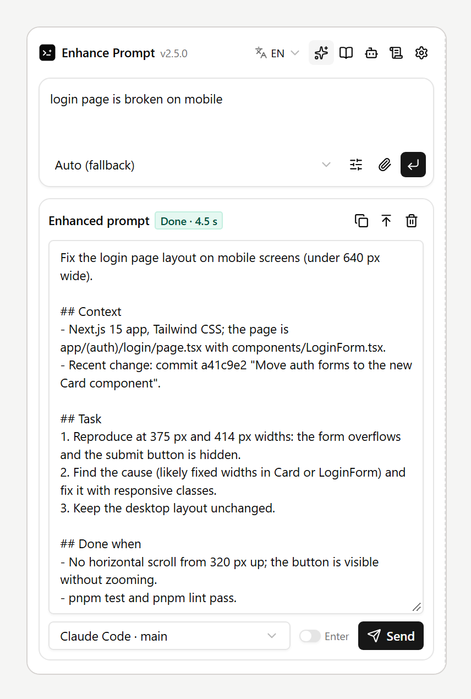
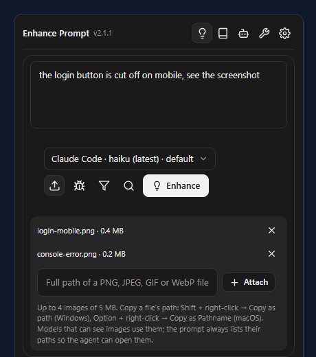
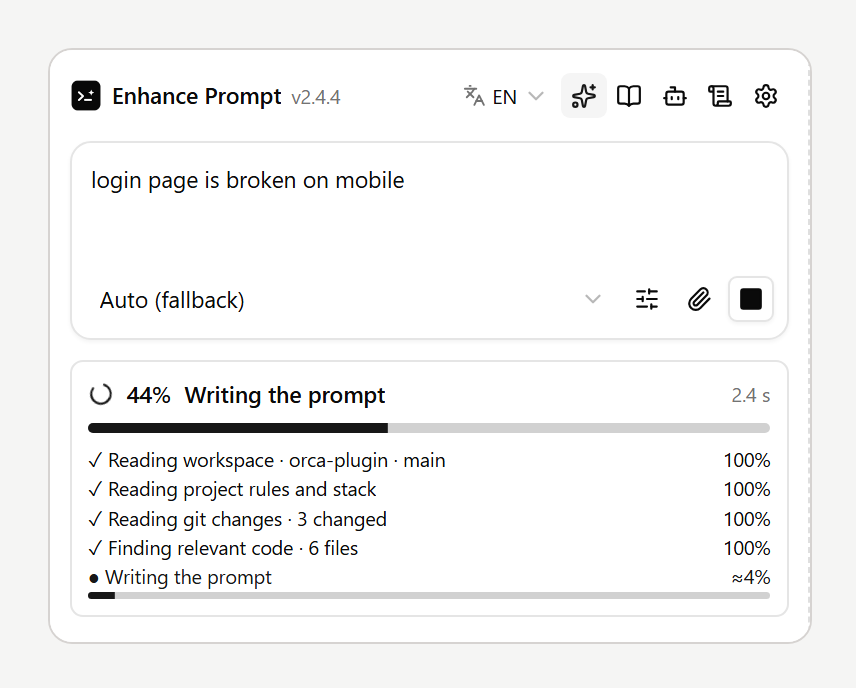
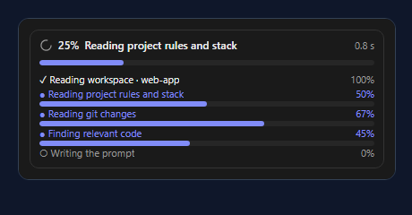
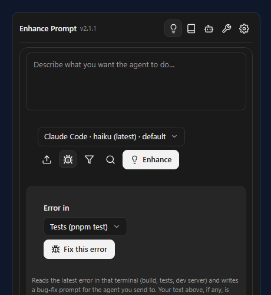
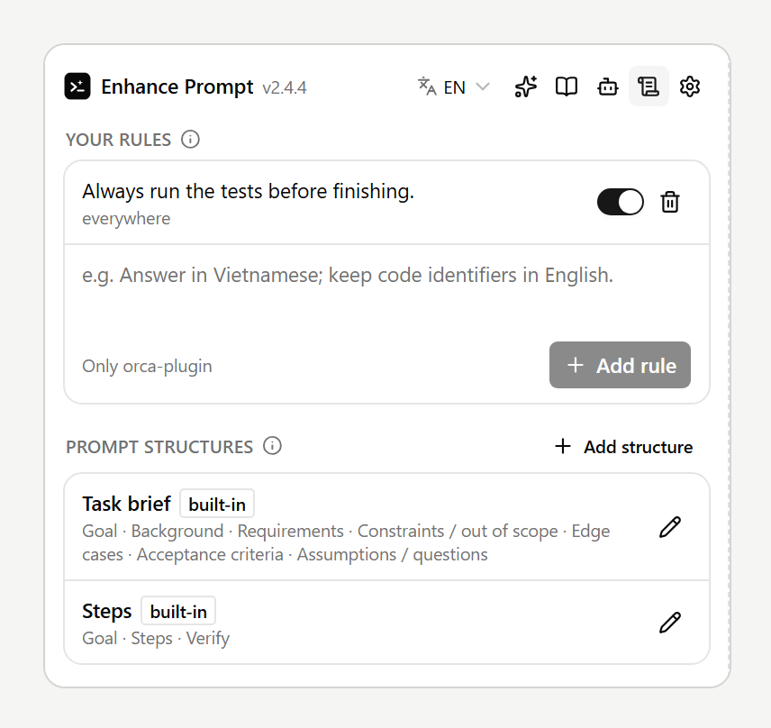
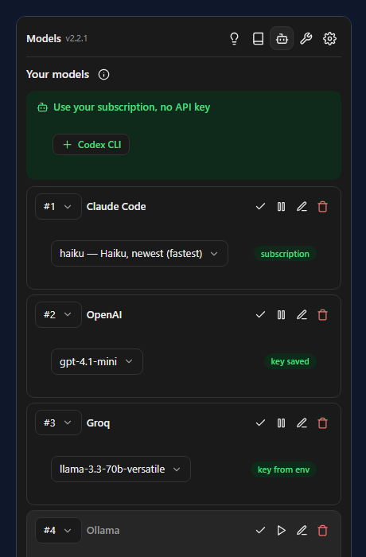
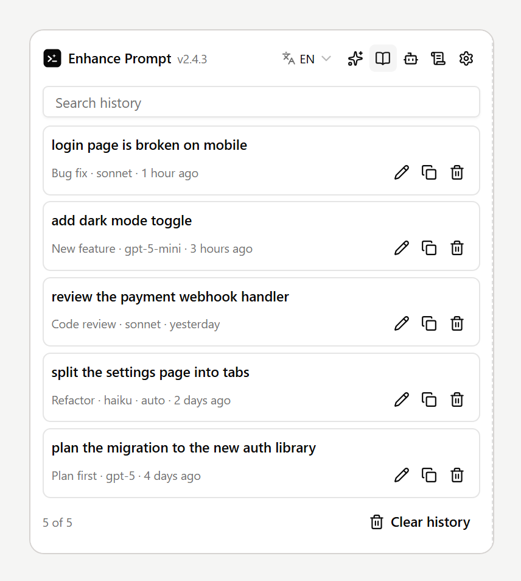

# User guide

How to use Enhance Prompt day to day, from a rough idea to a prompt in your agent's terminal. The
pictures use sample data; your panel shows your own projects and models.

- [1. Write, enhance, send](#1-write-enhance-send)
- [2. Attach images](#2-attach-images)
- [3. Follow the progress](#3-follow-the-progress)
- [4. Fix an error from a terminal](#4-fix-an-error-from-a-terminal)
- [5. Your rules and prompt structures](#5-your-rules-and-prompt-structures)
- [6. Models](#6-models)
- [7. History, projects and privacy](#7-history-projects-and-privacy)

Open the panel from the right sidebar (`Ctrl+L`, `⌘L` on macOS): the lightbulb tab **Enhance Prompt**.
The icons at the top switch between Enhance, History, Models, Rules and the gear (privacy, language
and feedback). The panel's language is under the gear; the name Enhance Prompt stays the same in
every language.

## 1. Write, enhance, send

1. Type what you want in a sentence or two, in any language.
2. Pick a model in the menu under the text (or **Auto**, which tries your models in order).
3. Press **Enhance** (`Ctrl+Enter`). The panel reads your project at the chosen context level and
   rewrites the request into a prompt with a goal, requirements and how to check the result.
4. Read and edit the result, pick the agent terminal, then press **Send**. Nothing reaches the agent
   before you press Send; turn on **Press Enter after sending** under Options to submit it too.

Under **Options** (under the prompt box): style (Balanced, Bug fix, Plan first…), how much project context
to read, the output language, and a prompt structure.

## 2. Attach images

Screenshots help when the problem is visual or the error is in a dialog.

1. Press **Images** under the prompt box.
2. Paste the **full path** of an image file on this machine and press **Attach** (or Enter).
   - Windows: Shift + right-click the file → **Copy as path** (the quotes are fine).
   - macOS: Option + right-click → **Copy "…" as Pathname**.
   - Linux: copy the path from your file manager; `file://` links work too.
3. Up to **4 images**, **5 MB** each, **PNG, JPEG, GIF or WebP**. A missing file, another type or a
   larger file is refused with the reason, before any model is called. The × removes an image.
4. Press **Enhance** as usual.

What happens to the images:

| Model | Sees the pictures? |
| --- | --- |
| Anthropic API, and the OpenAI, OpenRouter and Gemini presets | Yes, sent with the request |
| Codex CLI (subscription) | Yes, attached with `codex exec -i` |
| Claude Code and Gemini CLI (subscription), Groq, DeepSeek, Mistral, Ollama, LM Studio, custom endpoints | No: they get the paths only, and the panel says so |

Whatever the model, the enhanced prompt **lists every image by its path**, so the agent in the
terminal (Claude Code, Codex…) opens them itself. Images stay on your machine; they are read only to
send them to the model you picked. Orca's panels have no file picker, which is why images are
attached by path.

## 3. Follow the progress

While a prompt is written, the card shows the **total percentage** and every step with its own:

- reading the workspace, the project's rules and stack, git changes, the code that matches your
  request, the AI file picker and the terminal output, depending on the context level;
- steps that can be counted move as they go (git commands done, words searched, files read);
- the model call reports no progress of its own, so its share is an **estimate** from the time it
  has run, marked **≈**, and reaches 100% only when the answer arrives;
- `–` marks a step this run skips (for example git outside a repository).

The total is the weighted mean of the steps (the model call counts most), so it never passes 100%
and is 100% only when everything is done. **Cancel** stops the run; the card keeps the percentage it
had reached.

## 4. Fix an error from a terminal

When a build, test run or dev server fails in another terminal, the agent does not see it.

1. Press **Fix error** under the prompt box.
2. Under **Error in**, pick the terminal with the error (it starts on one that is not an agent).
3. Press **Fix this error**. The latest error block (up to 150 lines) goes first in the context and
   the prompt is written as a bug-fix brief for the agent you send to. Text already in the composer
   is added.

This reads terminal output, so it needs **Read terminal output** on under the gear.

## 5. Your rules and prompt structures

The **Rules** tab (wrench icon):

- **Your rules** are followed in every enhanced prompt and by AI auto-enhance, for every workspace or
  only the one you are in. Untick to pause one.
- **Prompt structures** are the headings a prompt is written under. Two are built in (Task brief,
  Steps); add your own with one heading per line, in any language. Pick one under **Options →
  Structure**.

More in [Rules, structures and Fix this error](rules-and-fixes.md).

## 6. Models

Add a model in the **Models** tab: a subscription CLI found on your machine (Claude Code, Codex,
Gemini CLI) in one click, or an API with its key. Models are tried top to bottom when one fails. See
[Models](models.md).

## 7. History, projects and privacy

- **History** keeps your enhanced prompts: search them, open one again, copy it. Clear asks twice.
- **Projects**: each project (workspace) keeps its own draft, images and result. Switch projects while
  a prompt is being written and it waits for its own project; it is never shown, or sent, in
  another one.
- **Privacy** (gear): switches for what the plugin may read or keep, and **Delete everything**. See
  [Privacy & permissions](privacy.md).
- **Feedback** (gear): something broken, confusing, or a prompt that came out wrong? [Open an issue
  on GitHub](https://github.com/cattfan/orca-enhance-prompt/issues/new).

The pictures in this guide are drawn from the panel itself with sample data:
`node scripts/make-guide-images.mjs`. To watch the progress card run, start `npm run dev` and open
<http://localhost:5173/mock-progress?lang=en>.
