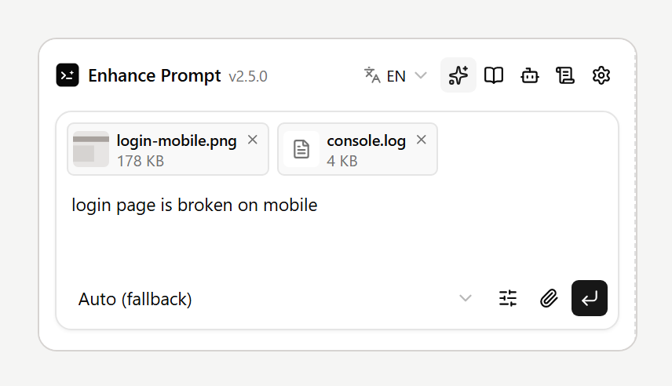
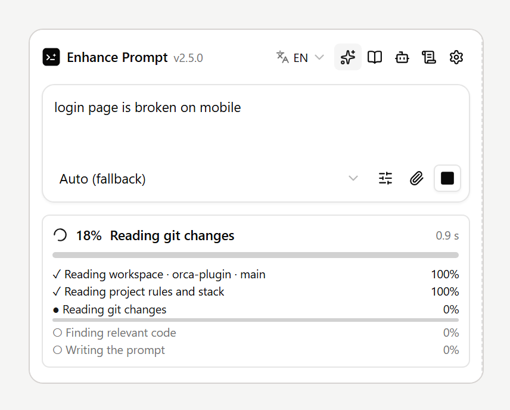
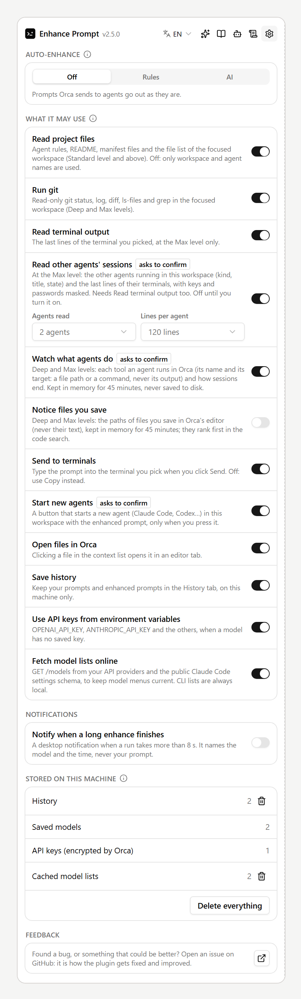
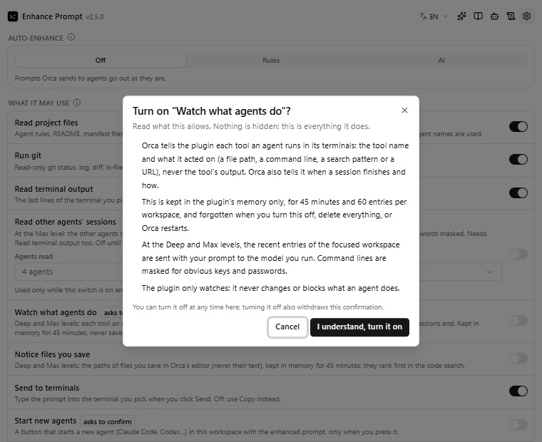
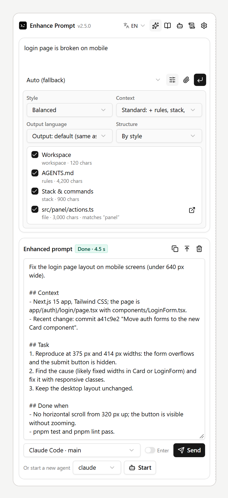

# User guide

How to use Enhance Prompt day to day, from a rough idea to a prompt in your agent's terminal. The
pictures use sample data; your panel shows your own projects and models.

- [1. Write, enhance, send](#1-write-enhance-send)
- [2. Attach files and screenshots](#2-attach-files-and-screenshots)
- [3. Follow the progress](#3-follow-the-progress)
- [4. Options and the context sent](#4-options-and-the-context-sent)
- [5. Your rules and prompt structures](#5-your-rules-and-prompt-structures)
- [6. Models](#6-models)
- [7. History, projects and privacy](#7-history-projects-and-privacy)
- [8. What's new](#8-whats-new)

Open the panel from the right sidebar (`Ctrl+L`, `⌘L` on macOS): the lightbulb tab **Enhance Prompt**.
The icons at the top right switch between Enhance, History, Models, Rules and Settings (privacy,
auto-enhance, stored data and feedback). The language menu sits just left of them.

## 1. Write, enhance, send

1. Type what you want in a sentence or two, in any language.
2. Pick a model in the menu under the text (or **Auto**, which tries your models in order).
3. Press **Enter** (or the ↵ button). Shift+Enter starts a new line. The panel reads your project at
   the chosen context level and rewrites the request into a prompt with a goal, requirements and how
   to check the result.
4. Read and edit the result, pick the agent terminal, then press **Send**. Nothing reaches the agent
   before you press Send; turn on the **Enter** switch next to Send to submit it too.

The buttons above the result: copy, move the result up into the prompt box to refine it, and clear.

## 2. Attach files and screenshots

- **Paste** a screenshot into the prompt box (Ctrl+V), **drop** files on it, or press the
  **paperclip** to pick them.
- Up to **8 files**, **10 MB** each. The × on a file removes it.

What happens to them:

- **Images** go to the models that read images (the Anthropic API, the OpenAI, OpenRouter and Gemini
  presets, and Codex CLI); other models get their paths.
- **Short text files** (logs, configs, code) are added to the context.
- The enhanced prompt **lists every file by its path**, so the agent in the terminal can open them.

The files are kept on this machine, in a temporary folder that is cleaned after a day.

## 3. Follow the progress

While a prompt is written, the card shows the **total percentage** and every step with its own:

- reading the workspace, the project's rules and stack, git changes, the code that matches your
  request, the AI file picker and the terminal output, depending on the context level;
- steps that can be counted move as they go (git commands done, words searched, files read);
- the model call reports no progress of its own, so its share is an **estimate** from the time it
  has run, marked **≈**, and reaches 100% only when the answer arrives;
- `–` marks a step this run skips (for example git outside a repository).

The square button stops the run; the card keeps the percentage it had reached.

## 4. Options and the context sent

The sliders button next to the model opens the options:

- **Style** (Balanced, Bug fix, Plan first…, or **Custom only** with your own instructions);
- **Context**: how much of the project is read;
- **Output language** of the prompt;
- **Structure**: the headings to write under.

Below them, the **context** that will be sent is listed, item by item (opening the options gathers it,
without calling a model). Untick what you do not want; after a run, the list shows what was used.

## 5. Your rules and prompt structures

- **Your rules** are followed in every enhanced prompt and by AI auto-enhance, in the project you
  add them in. The switch pauses one.
- **Prompt structures** are the headings a prompt is written under. The two built-in ones can be
  edited (and restored); add your own with one heading per line, in any language.

More in [Rules and prompt structures](rules-and-fixes.md).

## 6. Models

Add a model in the **Models** tab: a subscription CLI found on your machine (Claude Code, Codex,
Gemini CLI) in one click, or an API with its key. Models are tried top to bottom when one fails (the
**Fallback** switch). Each card has a test button and, under ⋮, edit, move up or down, and delete. See
[Models](models.md).

## 7. History, projects and privacy

- **History** keeps your enhanced prompts: search them, open one again, copy it. Clear asks twice.
- **Projects**: each project (workspace) keeps its own draft, files and result. Switch projects while
  a prompt is being written and it waits for its own project; it is never shown, or sent, in
  another one.
- **Settings** (gear): switches for what the plugin may read or keep, auto-enhance, what is stored,
  and **Delete everything**. See [Privacy & permissions](privacy.md).

### Switches that read or do more (all off until you turn them on)

- **Read other agents' sessions** (Max level): the other agents in the workspace and the last lines of
  their terminals. Under the switch, pick **Agents read** (1 to 8, 4 by default) and **Lines per
  agent** (10 to 300, 80 by default); they do nothing while the switch is off.
- **Watch what agents do** (Deep and Max): the tools agents run and their targets, never the output.
- **Notice files you save** (Deep and Max): the paths of files you save in Orca's editor.
- **Start new agents** and **Open files in Orca**: buttons under the result and in the context list.

The switches that send more of your work to the model, or start programs, first show everything they
allow and ask you to confirm. Turned on in Orca's Settings alone, they stay off until you confirm in
the panel.

- **Feedback** (gear): something broken, confusing, or a prompt that came out wrong? [Open an issue
  on GitHub](https://github.com/cattfan/orca-enhance-prompt/issues/new).

## 8. What's new

Click the version next to the title for **What's new** in this version and the full **changelog**.
After an update, What's new opens once by itself.

The pictures in this guide are drawn from the panel itself with sample data: start the web panel's
dev server (`npm run web:dev`) and run `node scripts/make-listing.mjs`.
